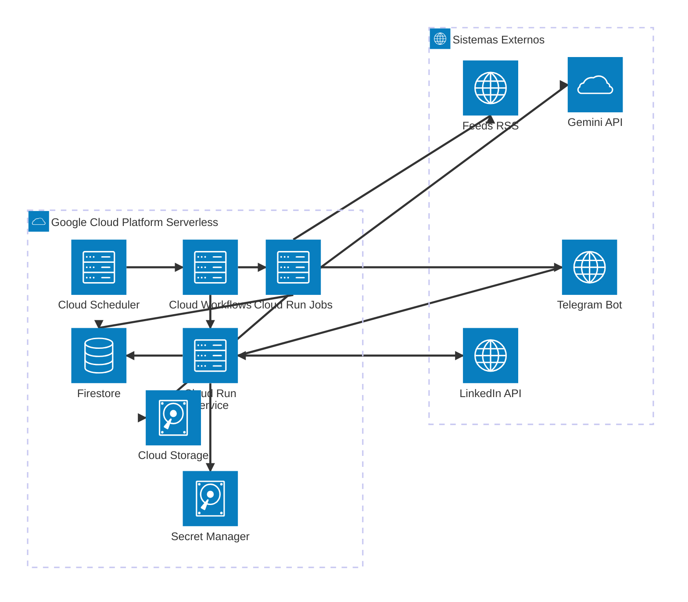
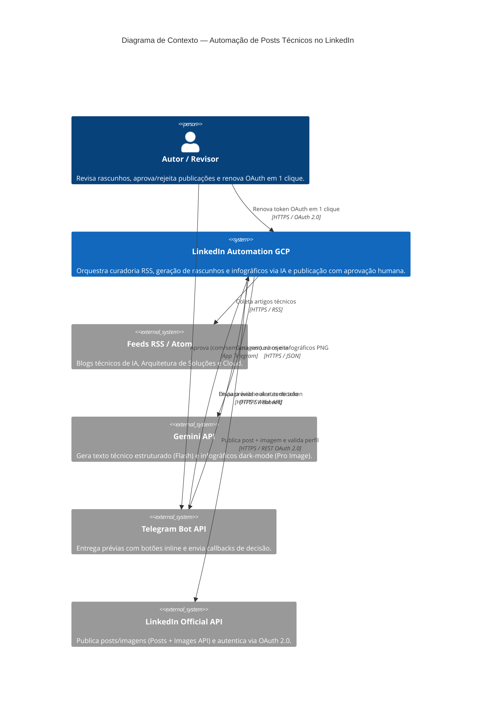
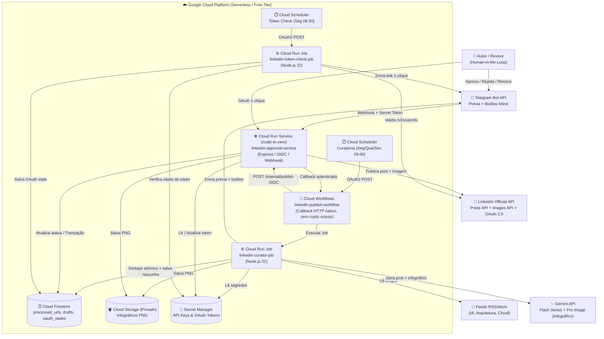
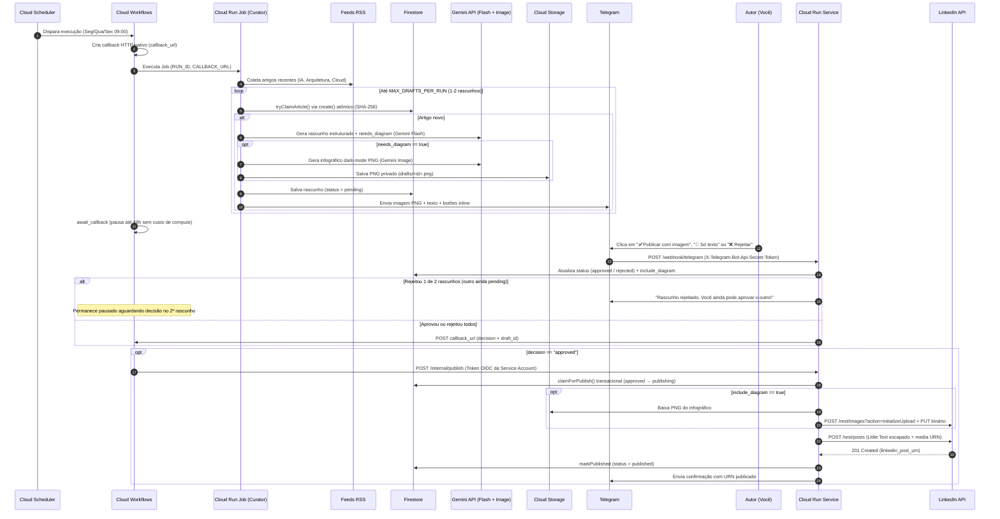
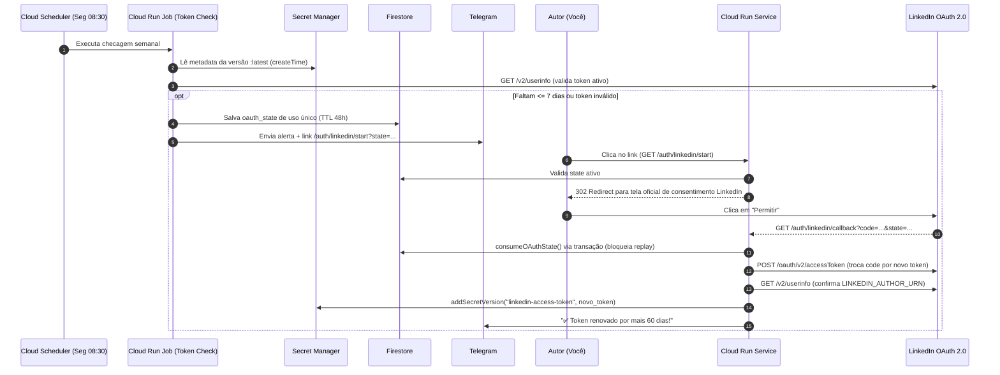

<div align="center">
  

  <p>
    
  </p>

  <p>
    
    
    
    
    
  </p>
</div>

# Automação de Posts Técnicos no LinkedIn (GCP Serverless + Node.js)

MVP completo em **Node.js 22 (ESM)** para curadoria automatizada de notícias de tecnologia (**IA, Arquitetura de Soluções e Cloud**), geração de rascunhos técnicos estruturados + infográficos dark-mode com **Gemini API (`@google/genai`)** e publicação no perfil pessoal via **LinkedIn Posts API & Images API oficiais** com **aprovação humana obrigatória (Human-in-the-Loop)**.

## Arquitetura (Free Tier friendly)

### Arquitetura Cloud (`architecture-beta`)



### C4 Model — Nível 1: Contexto (`C4Context`)



### C4 Model — Nível 2: Containers (`C4Container`)

```mermaid
C4Container
  title Diagrama de Containers — LinkedIn Automation GCP (Serverless)

  Person(author, "Autor / Revisor", "Aprova posts no Telegram e autoriza renovação OAuth.")

  System_Boundary(gcp, "Google Cloud Platform (Free Tier)") {
    Container(schedCurator, "Cloud Scheduler (Curadoria)", "GCP Cron", "Dispara o fluxo Seg/Qua/Sex às 09:00 BRT.")
    Container(schedToken, "Cloud Scheduler (Token)", "GCP Cron", "Verifica expiração do token toda Segunda às 08:30 BRT.")
    Container(workflows, "Cloud Workflows", "YAML / HTTP Callbacks", "Orquestra curadoria e pausa até 48h sem custo ocioso.")
    Container(jobCurator, "Curator Job", "Cloud Run Job / Node.js 22", "Lê RSS, deduplica, chama Gemini e notifica no Telegram.")
    Container(jobToken, "Token Check Job", "Cloud Run Job / Node.js 22", "Checa idade/validade do token e envia link de renovação.")
    Container(approvalSvc, "Approval & Publish Service", "Cloud Run Service / Express", "Scale-to-zero; recebe webhook Telegram, OAuth e /internal/publish.")
    ContainerDb(firestore, "Cloud Firestore", "NoSQL Native", "Persiste processed_urls, drafts e oauth_states transacionais.")
    ContainerDb(gcs, "Cloud Storage", "Bucket Privado", "Armazena infográficos PNG entre geração e publicação.")
    ContainerDb(secrets, "Secret Manager", "Cofre de Segredos", "Armazena API keys e versões do token OAuth do LinkedIn.")
  }

  System_Ext(rss, "Feeds RSS", "Artigos de tecnologia")
  System_Ext(gemini, "Gemini API", "Flash + Pro Image")
  System_Ext(telegram, "Telegram Bot API", "Notificações e botões")
  System_Ext(linkedin, "LinkedIn API", "Posts + Images + OAuth 2.0")

  Rel(schedCurator, workflows, "Dispara execução", "HTTPS / OAuth2")
  Rel(workflows, jobCurator, "Executa com RUN_ID e CALLBACK_URL", "Cloud Run API v2")
  Rel(jobCurator, rss, "Busca artigos", "HTTPS")
  Rel(jobCurator, gemini, "Gera texto e PNG", "HTTPS")
  Rel(jobCurator, gcs, "Faz upload do PNG", "HTTPS / GCS API")
  Rel(jobCurator, firestore, "Reserva URL e salva draft", "gRPC")
  Rel(jobCurator, telegram, "Envia prévia + botões", "HTTPS")

  Rel(author, telegram, "Clica em Aprovar / Rejeitar", "Telegram")
  Rel(telegram, approvalSvc, "POST /webhook/telegram", "HTTPS + Secret Token")
  Rel(approvalSvc, firestore, "Atualiza status / Transações", "gRPC")
  Rel(approvalSvc, workflows, "Dispara callback HTTP", "HTTPS / OAuth2")
  Rel(workflows, approvalSvc, "POST /internal/publish", "HTTPS / OIDC")
  Rel(approvalSvc, gcs, "Baixa PNG do infográfico", "HTTPS / GCS API")
  Rel(approvalSvc, linkedin, "Publica post e imagem", "HTTPS / REST")

  Rel(schedToken, jobToken, "Dispara checagem semanal", "Cloud Run API v2")
  Rel(jobToken, secrets, "Consulta createTime (:latest)", "HTTPS / Secret Manager")
  Rel(jobToken, telegram, "Envia link /auth/linkedin/start", "HTTPS")
  Rel(author, approvalSvc, "Autoriza renovação OAuth", "HTTPS")
  Rel(approvalSvc, secrets, "Salva nova versão do token", "HTTPS / Secret Manager")
```



### Visão Geral de Componentes (Fluxo Detalhado)



### Sequence Diagram — Fluxo Completo (Curadoria → Aprovação → Publicação)



### Sequence Diagram — Renovação do Token LinkedIn em 1 Clique



### Garantias de segurança e boas práticas
- **Human-in-the-Loop estrito**: `/internal/publish` recusa (`409 Conflict`) qualquer rascunho fora do status `approved` no Firestore e valida token **OIDC** da Service Account do Cloud Workflows (fail-closed em produção).
- **Webhook protegido**: `/webhook/telegram` valida `X-Telegram-Bot-Api-Secret-Token` em tempo constante (`timingSafeEqual`) e restringe aprovações ao `TELEGRAM_CHAT_ID` configurado.
- **Rejeição independente**: rejeitar 1 dos 2 rascunhos da execução não cancela o outro no Cloud Workflows — o workflow só encerra como `rejected` se todos os rascunhos da execução forem rejeitados.
- **Hardening HTTP & validação de entrada**: limite de payload (`64kb`), `x-powered-by` desabilitado, headers defensivos (`X-Content-Type-Options`, `X-Frame-Options`, `Referrer-Policy`, `Cache-Control: no-store`), validação estrita de `draftId`, objeto GCS (`drafts/*.png|jpg`) e host do callback (`*.googleapis.com`).
- **Idempotência**: URLs normalizadas e reservadas no Firestore via `create()` atômico (`SHA-256` como ID do documento), evitando duplicidade em entregas *at-least-once* do Cloud Scheduler.
- **Zero custo ocioso**: Cloud Workflows aguarda o callback sem compute ativo; Cloud Run Service roda com `--min-instances=0`; bucket GCS privado com uniform bucket-level access.
- **Somente API oficial**: usa `POST https://api.linkedin.com/rest/posts` e `POST https://api.linkedin.com/rest/images?action=initializeUpload` com escape *Little Text* (sem scraping nem automação de engajamento).

---

## Estrutura de pastas

```text
linkedin-automation-gcp/
├── GEMINI.md
├── README.md
├── package.json                     # Node.js 22 ESM + scripts start/job/token-check/test
├── Dockerfile                       # Imagem leve node:22-slim (usuário não-root)
├── .dockerignore
├── .env.example
├── .gitignore
├── src/
│   ├── config.js
│   ├── models.js
│   ├── clients/
│   │   ├── firestoreRepo.js         # Idempotência + ciclo de vida dos rascunhos
│   │   ├── gcsClient.js             # Upload/download autenticado de infográficos no GCS
│   │   ├── geminiClient.js          # Rascunho estruturado + infográfico dark-mode
│   │   ├── linkedinClient.js        # Posts API (com escape Little Text) + Images API
│   │   ├── rssReader.js             # Curadoria de feeds RSS/Atom
│   │   ├── secretManagerClient.js   # Metadados e rotação de versões no Secret Manager
│   │   ├── telegramClient.js        # Envio de PNG + rascunho com botões inline
│   │   └── workflowsClient.js       # Callback HTTP autenticado do Cloud Workflows
│   ├── job/
│   │   ├── main.js                  # Cloud Run Job (curadoria + geração)
│   │   └── tokenCheck.js            # Cloud Run Job (checagem semanal do token LinkedIn)
│   └── service/
│       ├── app.js                   # Express app (webhook, OAuth 1-clique, publish OIDC)
│       └── server.js                # Entrypoint HTTP com graceful shutdown (PORT=8080)
├── workflows/
│   └── linkedin_publish_workflow.yaml
└── tests/
    ├── firestoreRepo.test.js
    ├── geminiClient.test.js
    ├── jobMain.test.js
    ├── linkedinClient.test.js
    ├── rssReader.test.js
    ├── serviceApp.test.js
    └── tokenCheck.test.js
```

---

## Desenvolvimento local e testes

```bash
npm install
npm test

cp .env.example .env
# Preencha o .env (sem aspas nos valores)
npm start                    # Sobe o Express na porta 8080
DRY_RUN=true npm run job     # Executa o Cloud Run Job localmente
```

---

## Deploy na GCP (`gcloud`)

<details open>
<summary><strong>Comandos passo a passo</strong></summary>

#### 1. Carregar variáveis de ambiente
```bash
set -a && source .env && set +a
export SA_NAME="linkedin-automation-sa"
export SA_EMAIL="${SA_NAME}@${GCP_PROJECT_ID}.iam.gserviceaccount.com"
export IMAGE_URI="${GCP_REGION}-docker.pkg.dev/${GCP_PROJECT_ID}/linkedin-automation/linkedin-automation:latest"
```

#### 2. Habilitar APIs, criar Firestore, Service Account, IAM, Artifact Registry e Bucket GCS
```bash
gcloud auth login
gcloud config set project "${GCP_PROJECT_ID}"

gcloud services enable \
  run.googleapis.com \
  workflows.googleapis.com \
  cloudscheduler.googleapis.com \
  firestore.googleapis.com \
  secretmanager.googleapis.com \
  artifactregistry.googleapis.com \
  cloudbuild.googleapis.com

gcloud firestore databases create --location="${GCP_REGION}" --type=firestore-native

gcloud iam service-accounts create "${SA_NAME}" \
  --display-name="LinkedIn Automation Serverless SA"

for ROLE in \
  roles/datastore.user \
  roles/secretmanager.secretAccessor \
  roles/storage.objectAdmin \
  roles/run.invoker \
  roles/run.developer \
  roles/workflows.invoker \
  roles/workflows.editor \
  roles/logging.logWriter; do
  gcloud projects add-iam-policy-binding "${GCP_PROJECT_ID}" \
    --member="serviceAccount:${SA_EMAIL}" \
    --role="${ROLE}" \
    --condition=None \
    --quiet
done

gcloud artifacts repositories create linkedin-automation \
  --repository-format=docker \
  --location="${GCP_REGION}"

gcloud storage buckets create "gs://${GCS_BUCKET}" \
  --location="${GCP_REGION}" \
  --uniform-bucket-level-access
```

#### 3. Criar os segredos no Secret Manager
```bash
printf "%s" "${GEMINI_API_KEY}" | gcloud secrets create gemini-api-key --data-file=-
printf "%s" "${TELEGRAM_BOT_TOKEN}" | gcloud secrets create telegram-bot-token --data-file=-
printf "%s" "${TELEGRAM_WEBHOOK_SECRET}" | gcloud secrets create telegram-webhook-secret --data-file=-
printf "%s" "${LINKEDIN_ACCESS_TOKEN}" | gcloud secrets create linkedin-access-token --data-file=-
```

#### 4. Build da imagem Docker (Cloud Build)
```bash
gcloud builds submit --tag "${IMAGE_URI}" .
```

#### 5. Deploy do Cloud Run Service (scale-to-zero)
```bash
gcloud run deploy linkedin-approval-service \
  --image="${IMAGE_URI}" \
  --region="${GCP_REGION}" \
  --service-account="${SA_EMAIL}" \
  --allow-unauthenticated \
  --min-instances=0 \
  --max-instances=2 \
  --memory=512Mi \
  --cpu=1 \
  --set-env-vars="GCP_PROJECT_ID=${GCP_PROJECT_ID},GCP_REGION=${GCP_REGION},GCS_BUCKET=${GCS_BUCKET},TELEGRAM_CHAT_ID=${TELEGRAM_CHAT_ID},LINKEDIN_AUTHOR_URN=${LINKEDIN_AUTHOR_URN},LINKEDIN_API_VERSION=${LINKEDIN_API_VERSION},WORKFLOWS_SERVICE_ACCOUNT=${SA_EMAIL}" \
  --set-secrets="TELEGRAM_BOT_TOKEN=telegram-bot-token:latest,TELEGRAM_WEBHOOK_SECRET=telegram-webhook-secret:latest,LINKEDIN_ACCESS_TOKEN=linkedin-access-token:latest"

SERVICE_URL="$(gcloud run services describe linkedin-approval-service --region="${GCP_REGION}" --format='value(status.url)')"

gcloud run services update linkedin-approval-service \
  --region="${GCP_REGION}" \
  --update-env-vars="APPROVAL_SERVICE_URL=${SERVICE_URL}"
```

#### 6. Deploy do Cloud Run Job (curadoria RSS + Gemini)
```bash
gcloud run jobs deploy linkedin-curator-job \
  --image="${IMAGE_URI}" \
  --region="${GCP_REGION}" \
  --service-account="${SA_EMAIL}" \
  --command="node" \
  --args="src/job/main.js" \
  --tasks=1 \
  --max-retries=1 \
  --task-timeout=300s \
  --memory=512Mi \
  --cpu=1 \
  --set-env-vars="^|^GCP_PROJECT_ID=${GCP_PROJECT_ID}|GCP_REGION=${GCP_REGION}|GCS_BUCKET=${GCS_BUCKET}|TELEGRAM_CHAT_ID=${TELEGRAM_CHAT_ID}|APPROVAL_SERVICE_URL=${SERVICE_URL}|RSS_FEEDS=${RSS_FEEDS}|MAX_DRAFTS_PER_RUN=${MAX_DRAFTS_PER_RUN}|GEMINI_MODEL=${GEMINI_MODEL}|GEMINI_IMAGE_MODEL=${GEMINI_IMAGE_MODEL}" \
  --set-secrets="GEMINI_API_KEY=gemini-api-key:latest,TELEGRAM_BOT_TOKEN=telegram-bot-token:latest"
```

#### 7. Deploy do Cloud Workflows e Cloud Scheduler
```bash
gcloud workflows deploy linkedin-publish-workflow \
  --location="${GCP_REGION}" \
  --source="workflows/linkedin_publish_workflow.yaml" \
  --service-account="${SA_EMAIL}"

gcloud scheduler jobs create http linkedin-curator-schedule \
  --location="${GCP_REGION}" \
  --schedule="0 9 * * 1,3,5" \
  --time-zone="America/Sao_Paulo" \
  --uri="https://workflowexecutions.googleapis.com/v1/projects/${GCP_PROJECT_ID}/locations/${GCP_REGION}/workflows/linkedin-publish-workflow/executions" \
  --http-method=POST \
  --oauth-service-account-email="${SA_EMAIL}" \
  --headers="Content-Type=application/json" \
  --message-body="{\"argument\":\"{\\\"project_id\\\":\\\"${GCP_PROJECT_ID}\\\",\\\"region\\\":\\\"${GCP_REGION}\\\",\\\"job_name\\\":\\\"linkedin-curator-job\\\",\\\"approval_service_url\\\":\\\"${SERVICE_URL}\\\",\\\"approval_timeout_seconds\\\":172800}\"}"
```

#### 8. Registrar webhook do Telegram e executar teste manual
```bash
curl -fsS -X POST "https://api.telegram.org/bot${TELEGRAM_BOT_TOKEN}/setWebhook" \
  -H "Content-Type: application/json" \
  -d "{\"url\":\"${SERVICE_URL}/webhook/telegram\",\"secret_token\":\"${TELEGRAM_WEBHOOK_SECRET}\",\"allowed_updates\":[\"callback_query\"]}"

gcloud workflows run linkedin-publish-workflow \
  --location="${GCP_REGION}" \
  --data="{\"project_id\":\"${GCP_PROJECT_ID}\",\"region\":\"${GCP_REGION}\",\"job_name\":\"linkedin-curator-job\",\"approval_service_url\":\"${SERVICE_URL}\",\"approval_timeout_seconds\":172800}"
```

</details>

---

### Renovação do token do LinkedIn (alerta automático + 1 clique)
O token OAuth 2.0 do LinkedIn dura **60 dias** (o LinkedIn não libera `refresh_token` automático para apps pessoais). Para evitar expiração surpresa:

1. Um **Cloud Scheduler semanal** (`linkedin-token-check-schedule`, segundas às 08:30 `America/Sao_Paulo`) executa o **Cloud Run Job** `linkedin-token-check-job` ([tokenCheck.js](src/job/tokenCheck.js)).
2. Quando faltarem **≤ 7 dias** para expirar (ou se o token estiver inválido), o bot envia automaticamente um **link único de renovação** no Telegram.
3. Ao clicar no link, você autoriza na tela oficial do LinkedIn e o **Cloud Run Service** (`/auth/linkedin/callback`) salva automaticamente a nova versão de `linkedin-access-token` no Secret Manager — **sem abrir terminal**.

**Pré-requisito no LinkedIn Developer Portal** (aba **Auth → OAuth 2.0 settings → Authorized redirect URLs**):
adicione `https://<SUA_SERVICE_URL>/auth/linkedin/callback` e configure `LINKEDIN_CLIENT_ID` e o segredo `linkedin-client-secret` no Secret Manager.

*(Caso prefira renovar manualmente: `printf "%s" "NOVO_TOKEN" | gcloud secrets versions add linkedin-access-token --data-file=-`.)*


